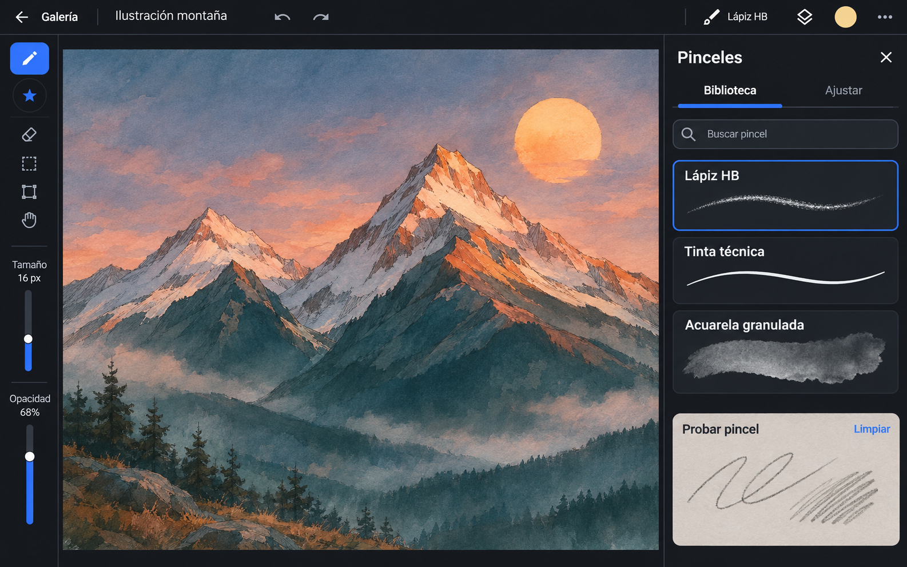

# Propuesta de diseño · Espacio de pinceles

Propuesta para Canvas Studio en tabletas Android, con la Galaxy Tab S8 como dispositivo de referencia. El render es un concepto visual, no una captura de una función instalada.

## Qué cambia al pintar

- El lienzo ocupa el centro. Pincel activo, color y capas se abren desde la barra superior. El panel de pinceles se cierra sin perder la búsqueda, la posición de la lista ni el pincel seleccionado.
- Tamaño y opacidad pasan a una barra que se puede colocar del lado de la mano libre. Los controles muestran el valor y mantienen el área táctil aunque el carril visible sea delgado. El acceso rápido radial se mantiene configurable.
- Un único panel tiene dos niveles. **Biblioteca** permite buscar, filtrar por material y recuperar favoritos o recientes. **Ajustar** conserva el pincel elegido y muestra primero los parámetros relevantes para ese material. Punta, grano, presión, inclinación y mezcla se despliegan por separado.
- **Probar pincel** es un papel temporal, nunca una capa del proyecto. Permite comprobar el pincel con el S Pen, limpiar los trazos y cambiar entre papel claro y oscuro. Para medios húmedos, conviene incluir un modo con pigmento previo y permitir superponer dos trazos.

## Referencias y qué adaptar

| Referencia | Qué aporta a Canvas Studio |
|---|---|
| [Krita · Brush Settings](https://docs.krita.org/en/reference_manual/brushes/brush_settings.html) y [guardado de pinceles](https://docs.krita.org/en/user_manual/loading_saving_brushes.html) | Probar un ajuste en una superficie independiente y guardar cambios como un preset, sin alterar el pincel original. |
| [Infinite Painter · selector y controles](https://docs.infinitestudio.art/painter/brushes/controls/) y [Brush Editor](https://docs.infinitestudio.art/painter/brushes/settings/?lang=en) | Diferenciar los controles frecuentes de la edición detallada. Mostrar una muestra al elegir y curvas cuando se está ajustando cómo responde el pincel. |
| [Clip Studio Paint · Simple Mode y Studio Mode](https://help.clip-studio.com/en-us/manual_en/090_tablet/Simple_Mode_and_Studio_Mode.htm) | Mantener la superficie de trabajo simple y revelar controles adicionales cuando se necesitan. Aquí bastan dos pestañas del mismo panel, sin cambiar todo el espacio de trabajo. |

## Pinceles: qué conservar y qué verificar

La vista previa actual ya usa el raster del proyecto fuera del hilo principal. Parte de una trayectoria predefinida con presión, inclinación y velocidad; se dibuja en blanco sobre un bitmap transparente, se recorta al área de tinta y se adapta al tamaño de la tarjeta. Sirve para identificar el trazo, pero el recorte y el reescalado dificultan comparar el tamaño físico. Además, una sola muestra no basta para evaluar la mezcla húmeda o cómo responde el S Pen de cada persona.

1. **Muestras comparables.** Renderizar a una escala común y con el mismo fondo para comparar presets; mostrar una muestra adicional específica del material. Grafito: línea suave, presión y sombreado inclinado. Tinta: borde y taper. Acuarela: lavado y dos pasadas. Óleo: huella de cerda y mezcla sobre pigmento.
2. **Papel de prueba.** Usar el mismo muestreo, presión, inclinación y raster que el lienzo real, con una superficie pequeña y aislada. Probar que no entra en el historial del documento, no activa el guardado automático y no modifica los píxeles del proyecto.
3. **Ajustes que se entienden.** Mostrar tamaño, opacidad y controles propios del material antes de las curvas avanzadas. Probar cambios al instante; **Guardar copia** y **Restablecer** deben ser explícitos. Conservar la última muestra válida mientras se calcula la nueva, sin poner el render de muestras en el camino del S Pen.

La primera implementación debería cubrir la navegación del panel y el papel de prueba, validarlos en ambas orientaciones y comprobar con el S Pen los cuatro materiales. Una segunda etapa puede ajustar el comportamiento de cada preset con esas muestras como referencia. No hace falta reescribir el motor para empezar.

## Primera implementación

El acceso desde la barra superior y desde la rueda abre el mismo panel lateral. La búsqueda, los filtros y la posición de la biblioteca se conservan al cerrarlo; los trazos de prueba son temporales. **Ajustar** muestra controles según el material. Los parámetros especializados y la gestión de pinceles siguen accesibles desde **Ajustes avanzados y biblioteca**.

El papel de prueba comparte extracción de presión e inclinación, muestreo y raster con el editor. Usa dos bitmaps pequeños en memoria, no abre un segundo documento ni escribe en la caché de tiles. El fondo claro u oscuro es visual; los medios con captación de color pueden recoger pigmento de los trazos que ya están en el papel. Las tarjetas nuevas usan un encuadre fijo de 768 × 240 px, con recorte al límite del encuadre en vez de reescalar cada huella.

Los controles de tamaño y opacidad pueden moverse a ambos lados en los espacios con altura suficiente. Las ventanas bajas conservan la barra inferior. La forma de los pinceles del documento no cambia en esta entrega.

[Captura real de la primera implementación en la Galaxy Tab S8](images/canvas-studio-brush-workspace-tab-s8.png).

Pasaron `check`, `assembleDebug` y `assembleDebugAndroidTest`. En la Tab S8 pasaron 24 pruebas en horizontal y 3 en vertical con los APK finales. Se verificaron los cambios de pestaña, la búsqueda al reabrir, el arrastre y cambio de lado del control, y que dibujar o limpiar el papel no altera el compuesto del documento ni dispara guardado. La auditoría raster produjo 14 huellas distintas en 11 escenarios y las repitió en dos ejecuciones con el motor actual. No se reclama equivalencia con archivos de referencia de revisiones más antiguas.

Para repetir la validación en la tablet, ejecutar `scripts/test-brush-workspace.ps1 -Install` tras compilar. El script guarda el resultado completo en `app/build/tab-s8-brush-workspace-verified-*.log` y restaura la rotación y el tiempo de espera de pantalla. Sigue pendiente la valoración de grafito, tinta y mezcla húmeda con un S Pen físico.

Prompt del render generado a partir de la captura real

Use case: ui-mockup. Asset type: one high-fidelity product design render for Canvas Studio, a premium Android drawing app on a landscape Galaxy Tab S8. This must look like a genuinely buildable native app screenshot, full-bleed flat frontal view, wide landscape aspect about 16:10. No device bezel, no hands, no text outside the app. Reference image 1 is the current Canvas Studio screen; retain its charcoal surfaces, cool cobalt identity and a mountain subject, but create a visibly redesigned layout. Do not copy any other drawing app's brand or icons.

Composition: a single compact top app bar, a narrow left-hand control rail, a large central canvas, and a right dock open to Brushes occupying just under one third of the screen. Canvas remains dominant, fully visible, and not covered by menus. Show an original professional painterly mountain landscape on the canvas (dusk, terracotta light, teal shadows, convincing visible graphite edges and washes); the illustration is content, never the UI background. Left rail: two separated slim vertical sliders with quiet cobalt tracks and legible labels "Tamaño" and "Opacidad", values "16 px" and "68%"; a few small recognizable outline controls and one star for quick access. Header: "Galería", document name "Ilustración montaña", undo/redo icons; aligned right the selected brush name "Lápiz HB", layer icon and a color swatch. Avoid a large export CTA.

Right dock: header "Pinceles" with close icon. Two tabs "Biblioteca" and "Ajustar"; Biblioteca active. Search field "Buscar pincel". Three tall tappable rows with strong label hierarchy and each a genuinely different horizontally stretched textured sample on a dark swatch: "Lápiz HB" selected (thin broken graphite with grain), "Tinta técnica" (smooth dark ink in light neutral ink color on its dark swatch), "Acuarela granulada" (broad translucent wash with pooling edges). In the bottom part of the same dock, a clearly separate inset warm gray test surface labeled "Probar pincel" containing casual pencil scribbles and a short hatch; small unobtrusive "Limpiar" action in that card. It must read as an interactive scratchpad, not as part of the art.

Style: tactile and restrained professional tool, matte dark charcoal, almost-white type, cool gray separators, cobalt blue reserved for active controls. Consistent alignment, human-scale hit targets, plenty of breathing room. Render only the listed Spanish text verbatim, accents correct. No pseudo-text, marketing, charts, neon, glossy effects, extra floating dialogs, decorative boxes, duplicate panes or trademarks.

