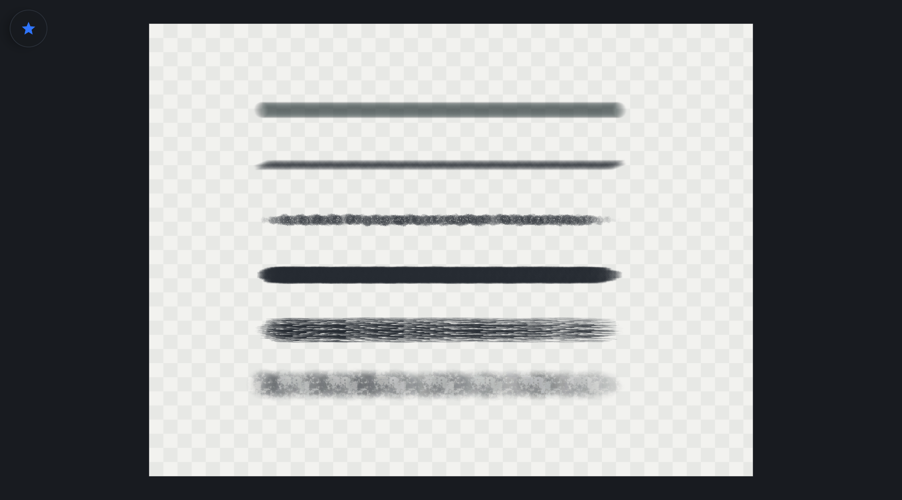
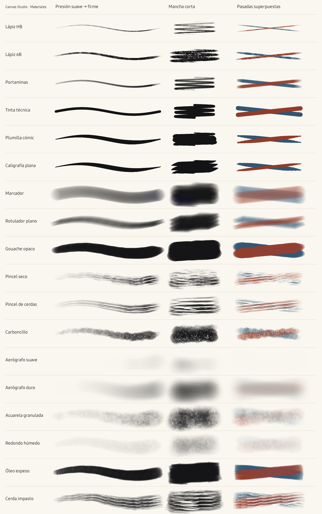

# Canvas Studio en la Galaxy Tab S8

Capturas de Canvas Studio 2.6.0-debug en una Samsung Galaxy Tab S8 (`SM-X700`, Android 16). Se usaron documentos de prueba; no hay proyectos ni datos personales. Las imágenes muestran la app en ejecución, no renders de diseño.

## Editor de dibujo

El dibujo de montaña permite comprobar uniones verticales y horizontales en un degradado. El borde exterior pertenece al lienzo.

## Seis pinceles en el lienzo

De arriba abajo: **Marcador**, **Rotulador plano**, **Carboncillo**, **Óleo espeso**, **Cerda impasto** y **Acuarela granulada**. La cuadrícula gris es el fondo de transparencia. Los trazos proceden del editor, con eventos de lápiz simulados en la tablet.

<strong>Ver el muestrario de los 18 pinceles</strong>

Muestrario generado por el motor de la app en la misma tablet. No es una captura de la interfaz ni una prueba manual de latencia.

[Volver al README](../README.md) · [Notas de 2.6.0](RELEASE_2.6.0.md)
